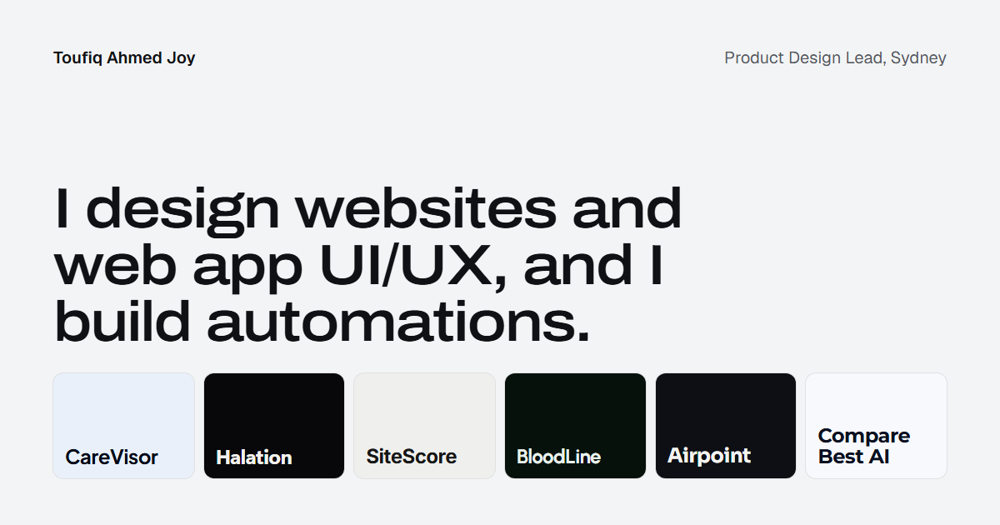

<div align="center">

<a href="https://toufiqahmedjoy.online"></a>

# Toufiq Ahmed Joy

**Product Design Lead · Sydney**

I design websites and web app UI/UX, and I build automations.<br />
This is my portfolio: six products, each one told in its own interface.

[**Visit toufiqahmedjoy.online →**](https://toufiqahmedjoy.online)
&nbsp;·&nbsp; [LinkedIn](https://www.linkedin.com/in/toufiqahmedjoy)
&nbsp;·&nbsp; [GitHub](https://github.com/AR13X3)

</div>

## The work

| | Project | What it is | My role | Links |
|---|---|---|---|---|
| 01 | **CareVisor** | The NDIS service provider platform, built in Australia: from participant intake to payroll, with every shift, document, incident and claim connected. | Designed the website and the product UI | [carevisor.com.au](https://carevisor.com.au) |
| 02 | **Halation** | A free, open-source editor for animated gradient backgrounds seen through textured glass. It runs on your GPU in the browser. | Designed and built it | [Open it](https://ar13x3.github.io/halation/) · [Repo](https://github.com/AR13X3/halation) |
| 03 | **SiteScore** | An open-source site-selection simulator that projects 36 months of revenue for candidate business locations, with risk ranges and a reason why each site wins or loses. | Designed and built it | [Open it](https://ar13x3.github.io/SiteScore/) · [Repo](https://github.com/AR13X3/SiteScore) |
| 04 | **BloodLine** | A safety net for blood test results in Australian general practice. It alerts the GP when a result may need review. | Led product and UI design | [Live site](https://ar13x3.github.io/Bloodline/) · [Repo](https://github.com/AR13X3/Bloodline) |
| 05 | **Airpoint** | Turns the S Pen of a Galaxy phone into a wireless mouse for a Windows PC. Wave to move, press to click. | Designed and built it | [Repo](https://github.com/AR13X3/airpoint) · [Download](https://github.com/AR13X3/airpoint/releases/latest) |
| 06 | **Compare Best AI** | A directory of AI tools for business. Every tool is scored on pricing, features and real-world capability, and compared side by side. | Led the visual identity, the UX and how comparisons are structured | [comparebestai.com](https://comparebestai.com) |

## How the site works

It's one page that you scroll through like a storyboard.

- **Two ways in.** A short loader, then a choice of intro. **One** fans the six products out like a swatch deck from the dot on the *i*. **Two** has the full stop of the name set off a chain reaction through all six. A switch at the top lets you try the other one.
- **Each project in its own UI.** Every chapter is rebuilt from the product's own fonts, components and motion, so CareVisor looks like CareVisor and Halation looks like Halation.
- **Bespoke transitions.** Moving from one chapter to the next morphs one product's interface into the next one's.
- **Built for every screen.** On desktop the story is pinned and scrubbed with the scroll. On phones each chapter reads as a page with short transitions between them. With reduced motion it uses fades only, and without JavaScript it's still a readable page.

Built with [Astro](https://astro.build), [GSAP](https://gsap.com) (ScrollTrigger) and [Lenis](https://lenis.darkroom.engineering), and deployed to GitHub Pages.

The internals (the intros, the motion engine, adding a chapter, checks and deploy) are in **[docs/ARCHITECTURE.md](docs/ARCHITECTURE.md)**.

## Run it locally

Needs Node 22.22 or later.

```bash
npm install
npm run dev        # http://localhost:4321/
npm run build      # static site in dist/
npm run preview    # serve dist/
```

## Credits

Chapter recreations are built from each project's own code and public site. BloodLine's
components are ported from its website (Apache-2.0, the BloodLine team).
